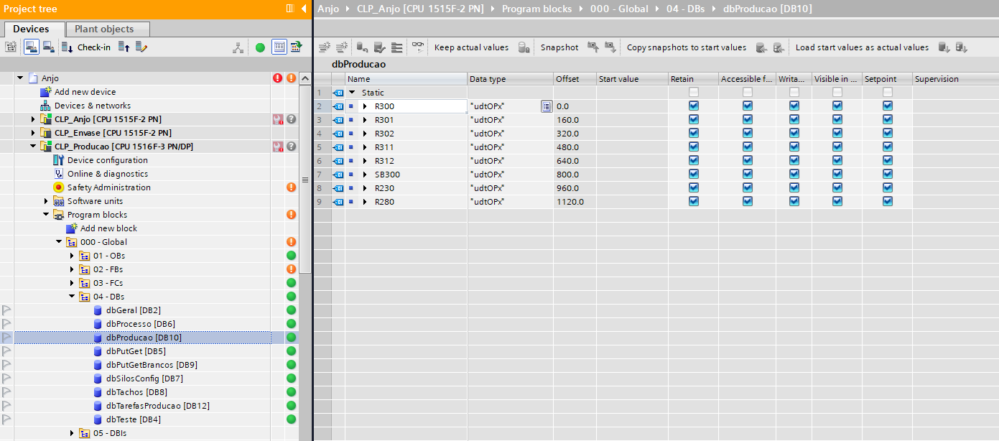

# Documentação Técnica: API REST e Payloads JSON

Contratos de comunicação entre os módulos do sistema. A visão geral do projeto está no [README principal](README.md).

```
DataManager  --POST /api/v1/telemetry/...-->  API  <--GET /api/v1/production/...--  Web App
```

## Convenções

- JSON em **snake_case** (`reactor_id`, `op_code`, ...).
- Datas em **ISO 8601 UTC** (`2026-11-04T08:00:00Z`).
- Pesos em **kg**.
- O DataManager **omite** os campos sem valor (ex.: `end_time` de uma OP em andamento). A API devolve esses campos como `null`.
- Um campo sem valor nunca é enviado como `0`: um REAL inválido no CLP (NaN) vira campo ausente.

## Origem do dado: DB10 no CLP

As OPs ficam no **DB10** (`dbProducao`) de cada CPU S7-1500, num array de `udtOPx` com 160 bytes por tanque:



| Campo no CLP | Tipo | Campo no JSON |
|---|---|---|
| `codigoOp` | String[14] | `op_code` |
| `status` | Int | `status` |
| `quantidadeSP` | Real | `requested_weight_kg` |
| `quantidadePV` | Real | `produced_weight_kg` |
| `nomeProduto` | String[12] | `product_code` |
| `dataStart` | DTL | `start_time` |
| `dataEnd` | DTL | `end_time` |
| `tarefaAtualInt` | Int | `current_step` |

O `reactor_id` é o nome do tanque na posição do array (ver [PlcCatalog.cs](DataManager/src/DataManager.Service/Config/PlcCatalog.cs)). Os offsets estão no [README do DataManager](DataManager/README.md#ops--reatores).

---

## 1. Recebimento (DataManager → API)

Aceito apenas de IPs da lista `security.allowed-ips.gateway`. Resposta de sucesso: **`204 No Content`**.

### 1.1 Uma OP por requisição

* **URL:** `POST /api/v1/telemetry/reactors`
* Usado com `Api:ReactorMode = Single` no DataManager.
* `plc_id` e `timestamp` são **obrigatórios**: a API não inventa a origem nem a hora da leitura.

```json
{
  "plc_id": "CLP1",
  "reactor_id": "R300",
  "op_code": "AAA",
  "product_code": "00000-00",
  "status": 2,
  "requested_weight_kg": 6500.0,
  "produced_weight_kg": 4900.0,
  "current_step": 15,
  "start_time": "2026-11-04T08:00:00Z",
  "timestamp": "2026-11-04T20:30:00Z"
}
```

### 1.2 Todas as OPs de um CLP (lote)

* **URL:** `POST /api/v1/telemetry/reactors/batch`
* Usado com `Api:ReactorMode = Batch` no DataManager (padrão).
* `plc_id` e `timestamp` vão uma vez, no topo. Valem para todos os tanques do lote.
* Tanque sem OP vai só com `reactor_id` e `op_code: ""`, e deixa de aparecer na consulta.
* Tanque que **não veio** no lote não é apagado: fica com a última leitura e passa a aparecer como desatualizado (`stale`).
* `reactor_id` repetido no mesmo lote → `400`.

```json
{
  "plc_id": "CLP2",
  "timestamp": "2026-11-05T14:49:07Z",
  "reactors": [
    { "reactor_id": "R210", "op_code": "AAAAAA00000", "product_code": "000000", "status": 2,
      "requested_weight_kg": 9999.0, "produced_weight_kg": 5555.4, "current_step": 3,
      "start_time": "2026-11-05T14:14:47Z" },
    { "reactor_id": "R211", "op_code": "" }
  ]
}
```

### Regras de recebimento

| Situação | Resultado |
|---|---|
| Leitura mais antiga que a já registrada para o tanque | Descartada (aviso no log); não sobrescreve a mais nova |
| `timestamp` mais de 5 min no futuro (`telemetry.max-clock-skew`) | `400`: relógio do gateway errado |
| Campo obrigatório ausente ou JSON inválido | `400` |
| IP fora da lista `gateway` | `403` |

O estado é identificado por **CLP + tanque**, porque o mesmo nome existe nos dois CLPs (ex.: R280).

---

## 2. Consulta (Web App → API)

Aceito apenas de IPs da lista `security.allowed-ips.viewers`.

### 2.1 OPs em produção

* **URL:** `GET /api/v1/production/reactors`
* Retorna **somente os tanques com OP ativa** (`op_code` preenchido), ordenados por CLP e tanque.

```json
{
  "total_active_ops": 2,
  "last_update": "2026-11-04T20:30:05Z",
  "reactors": [
    {
      "plc_id": "CLP1",
      "reactor_id": "R300",
      "op_code": "AAA",
      "product_code": "00000-00",
      "status": 2,
      "requested_weight_kg": 6500.0,
      "produced_weight_kg": 4900.0,
      "remaining_weight_kg": 1600.0,
      "current_step": 15,
      "start_time": "2026-11-04T08:00:00Z",
      "end_time": null,
      "last_update": "2026-11-04T20:30:05Z",
      "stale": false
    },
    {
      "plc_id": "CLP2",
      "reactor_id": "R210",
      "op_code": "AAB",
      "product_code": "00000-01",
      "status": 11,
      "requested_weight_kg": 3000.0,
      "produced_weight_kg": 3012.5,
      "remaining_weight_kg": -12.5,
      "current_step": 40,
      "start_time": "2026-11-04T13:15:00Z",
      "end_time": "2026-11-04T19:02:00Z",
      "last_update": "2026-11-04T20:29:40Z",
      "stale": true
    }
  ]
}
```

| Campo | Significado |
|---|---|
| `total_active_ops` | Quantidade de tanques com OP ativa |
| `last_update` (topo) | Hora da leitura mais recente recebida de qualquer CLP (relógio do gateway) |
| `remaining_weight_kg` | `requested - produced`, sem arredondar. **Negativo** = produziu acima do programado. `null` se faltar um dos pesos |
| `last_update` (tanque) | Hora em que o CLP foi lido para este tanque |
| `stale` | `true` = a API não recebe leitura nova deste tanque há mais de 30 s (`telemetry.stale-after`); os valores podem não ser os atuais |

O `status` é o código numérico do CLP. O frontend traduz para texto e cor com a tabela de [opStatus.js](FrontEnd/src/config/opStatus.js), de `0` (Programado) a `11` (Finalizada).

---

## 3. Erros

Os erros de validação e de acesso devolvem uma mensagem pronta para exibir. Um JSON malformado recebe a resposta de erro padrão do Spring.

```json
{ "message": "timestamp 2026-11-05T15:00:00Z está no futuro (agora: 2026-11-05T14:49:07Z). Verifique o relógio do gateway." }
```

| Código | Quando |
|---|---|
| `400` | Payload inválido ou regra de recebimento violada |
| `403` | IP de origem não autorizado, ou rota/método que não existe na API |

Detalhes da segurança por IP no [README do BackEnd](BackEnd/README.md#segurança-só-ips-previamente-autorizados).

---

<details>
<summary><b>Fora do escopo deste trabalho: contratos previstos para moinhos</b></summary>

Contratos combinados com a Anjo Tintas para uma etapa futura, **não implementados** na API.

`POST /api/v1/telemetry/mills`

```json
{ "mill_id": "M-200", "name": "Moinho 200", "production_today_kg": 4500.0, "timestamp": "2026-11-04T20:30:00Z" }
```

`GET /api/v1/milling/summary`

```json
{
  "unit": "kg",
  "date": "2026-11-04",
  "total_milled_today_kg": 4550.0,
  "mills": [
    { "mill_id": "M-200", "name": "Moinho 200", "production_today_kg": 4500.0 },
    { "mill_id": "M-201", "name": "Moinho 201", "production_today_kg": 50.0 }
  ]
}
```

</details>
