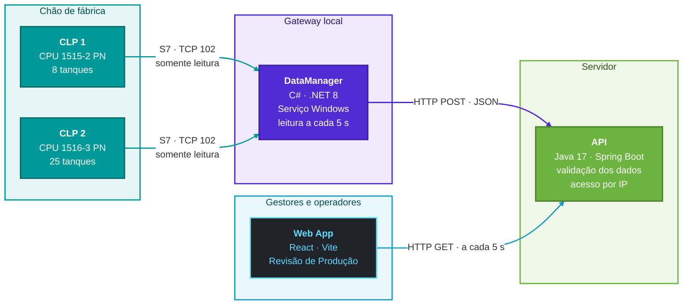
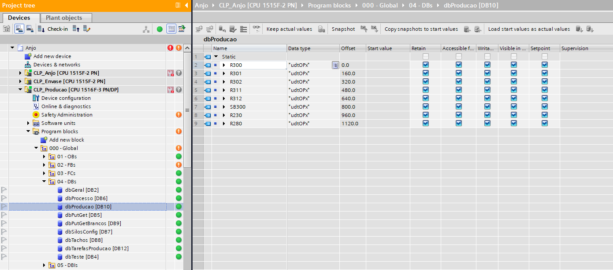

# Sistema Cloud de Monitoramento de Produção Industrial para o Setor Químico

> Projeto acadêmico individual com a **Anjo Tintas** como estudo de caso.


| | |
|---|---|
| **Integrante** | Silvio Virtuoso Júnior *(trabalho individual)* |
| **Empresa parceira** | Anjo Tintas |
| **Trilha formativa** | Automação Industrial e Engenharia de Software |

---

## Sumário

- [N1A: Proposta inicial](#n1a-proposta-inicial)
  - [1. Nome do integrante](#1-nome-do-integrante)
  - [2. Trilha formativa](#2-trilha-formativa)
  - [3. Título do projeto](#3-título-do-projeto)
  - [4. Objetivo](#4-objetivo)
  - [5. Justificativa](#5-justificativa)
  - [6. Breve descrição da solução](#6-breve-descrição-da-solução)
  - [7. Tecnologias previstas](#7-tecnologias-previstas)
- [N1B: Evolução do projeto](#n1b-evolução-do-projeto)
- [N1C: Entrega final](#n1c-entrega-final)
- [Estrutura do repositório](#estrutura-do-repositório)

---

## N1A: Proposta inicial

### 1. Nome do integrante

**Silvio Virtuoso Júnior**, projeto desenvolvido individualmente.

### 2. Trilha formativa

**Automação Industrial e Engenharia de Software**

### 3. Título do projeto

**Sistema Cloud de Monitoramento de Produção Industrial para o Setor Químico**

### 4. Objetivo

Desenvolver uma solução de monitoramento em tempo real da **fabricação de lotes** na Anjo Tintas, acompanhando as **ordens de produção (OPs)** em andamento nos tanques e reatores.

O sistema lê continuamente os dados das OPs direto dos **CLPs Siemens** do chão de fábrica e os envia para uma **API**. Assim, gestores e operadores acompanham de qualquer lugar, pelo navegador, o produto em fabricação, a quantidade produzida, a etapa atual e o status de cada OP.

### 5. Justificativa

No setor químico, saber na hora em que etapa está cada lote é essencial para evitar **gargalos**, **perdas de matéria-prima** e **atrasos na produção**.

Hoje esses dados só aparecem nas telas locais das máquinas (IHMs). Para saber como está a produção, é preciso ir até o painel ou perguntar ao operador. Com os dados disponíveis pela web:

- a gestão vê **todas as OPs em andamento num só painel**, em tempo real;
- o painel pode ficar aberto numa **TV** da fábrica ou no **celular**;
- a equipe **percebe mais cedo** um lote parado ou atrasado.

### 6. Breve descrição da solução

A solução tem **4 camadas**:

| # | Camada | Responsabilidade |
|---|---|---|
| 1 | **Chão de fábrica** | Dois CLPs Siemens S7-1500 (CPU 1515-2 PN e CPU 1516-3 PN) controlam o processo e guardam as OPs de cada tanque no DB10. |
| 2 | **Serviço local de coleta** | Serviço Windows em **C# (.NET)** que lê os CLPs pelo protocolo **S7** a cada 5 segundos, sem escrever nada neles, converte os dados em JSON e os envia para a API. |
| 3 | **API** | API em **Java com Spring Boot** que recebe as leituras, descarta dados inválidos ou atrasados, mantém o estado atual de cada tanque e só atende endereços IP autorizados. |
| 4 | **Frontend web** | Interface **React** responsiva com o painel de **Revisão de Produção**: um card por tanque com OP ativa. |

#### Arquitetura



### 7. Tecnologias previstas

| Camada | Tecnologia |
|---|---|
| Programação do CLP | **Siemens TIA Portal**, CLPs **S7-1500** |
| Coleta local | **C# (.NET 8)** como Serviço Windows e **Sharp7** (versão C# do Snap7) para o protocolo S7 |
| API | **Java 17** com **Spring Boot 3.5** e **Spring Security** (filtro de IPs autorizados) |
| Frontend | **React 19** com **Vite 6** |
| Implantação | Serviços Windows com início automático; o hospedeiro da API em .NET também serve o frontend |

---

## N1B: Evolução do projeto

### Andamento

O fluxo completo **CLP → DataManager → API → tela** está funcionando com os dois CLPs, 33 tanques no total.

**Chão de fábrica**
- [x] Levantamento do processo de fabricação de lotes com a Anjo Tintas
- [x] Mapeamento do DB10 (`dbProducao`) e do UDT da OP (`udtOPx`, 160 bytes por tanque) no TIA Portal
- [x] CLPs configurados para leitura externa (PUT/GET liberado e DB sem acesso otimizado)

**Serviço local de coleta (C#)**
- [x] Comunicação S7 com os 2 CLPs; se um cair, o outro continua sendo lido
- [x] Leitura do array de OPs inteiro numa única requisição por CLP
- [x] Decodificação do UDT (String, Int, Real, DTL) e conversão para JSON
- [x] Envio para a API em lote (1 POST por CLP) ou individual (1 POST por OP)
- [x] Validação da configuração na inicialização: com erro, o serviço não sobe e lista os problemas
- [x] Execução como Serviço Windows, com logs no Visualizador de Eventos

**API (Spring Boot)**
- [x] Recebimento: `POST /api/v1/telemetry/reactors` e `/api/v1/telemetry/reactors/batch`
- [x] Consulta: `GET /api/v1/production/reactors`
- [x] Proteção contra dado falso: marca o tanque como desatualizado (`stale`), descarta leitura fora de ordem e recusa relógio adiantado
- [x] Controle de acesso por IP de origem, com uma lista para quem envia (`gateway`) e outra para quem consulta (`viewers`)
- [x] Testes automatizados (MockMvc) do recebimento e do filtro de segurança

**Frontend (React)**
- [x] Tela de **Revisão de Produção** responsiva (desktop, TV e celular)
- [x] Avisos de API fora do ar e de tanque sem leitura nova
- [x] Campo sem valor aparece como "—", nunca como 0
- [x] Identidade visual da Anjo Tintas e status da OP com as mesmas cores da IHM

**Implantação**
- [x] Instalador que compila tudo e cria os serviços `ClpApi` e `DataManager` com início automático

### Evidências

DB10 (`dbProducao`) no TIA Portal, de onde o DataManager lê as OPs:



Tela de Revisão de Produção no desktop (os códigos de OP e de produto foram ocultados):


No celular:


### Dificuldades encontradas e soluções

| Dificuldade | Solução adotada |
|---|---|
| Com "Optimized block access" ligado, o DB não tem endereços fixos e não pode ser lido de fora | DB10 configurado sem acesso otimizado; os offsets do UDT ficam documentados em `OpLayout.cs` |
| O mesmo nome de tanque existe nos dois CLPs (ex.: R280) | O estado na API é identificado por **CLP + tanque** |
| Relógio do CLP em horário local, mas a API trabalha em UTC | Opção `ClockIsUtc` no DataManager para converter as datas |
| REAL inválido no CLP (NaN) e ruído de precisão do float (0.1 → 0.100000001) | NaN vira "sem valor" (nunca 0) e o float é convertido via `decimal` |
| Tela mostrando dado antigo como se fosse atual quando o CLP ou o DataManager para | Marcação `stale` após 30 s sem leitura nova, com aviso e card cinza na tela |
| Filtrar o acesso por endereço MAC não é possível: depois do primeiro roteador a API só recebe o IP | Controle por lista de IPs autorizados, separando quem envia de quem consulta |
| O Java não roda sozinho como Serviço Windows | Hospedeiro em .NET (`ApiHost`) que mantém a API no ar e a reinicia se ela cair |

---

## N1C: Entrega final

- [x] Evolução do trabalho desde a proposta (N1A) até a solução final ([veja abaixo](#da-proposta-à-solução-final))
- [x] Demonstração da solução em funcionamento ([evidências da N1B](#evidências))
- [x] Documentação final ([veja abaixo](#documentação))
- [x] Apresentação

### Da proposta à solução final

Tudo o que foi proposto na N1A foi entregue e está em funcionamento na Anjo Tintas:

| Proposto na N1A | Entregue |
|---|---|
| Ler os dados das OPs direto dos CLPs Siemens | DataManager lê os **2 CLPs S7-1500** (33 tanques) pelo protocolo S7, sem escrever nada neles |
| Serviço local de coleta em C# | Serviço Windows em **.NET 8** com início automático, leitura a cada 5 s e logs no Visualizador de Eventos |
| API em Java com Spring Boot | API com endpoints de recebimento e consulta, proteção contra dado falso e controle de acesso por IP |
| Interface web em React | Painel de **Revisão de Produção** responsivo, usado no desktop, na TV e no celular |
| Acompanhamento remoto em tempo real | A tela atualiza a cada 5 s e avisa quando um dado está desatualizado |

### Aplicação dos conhecimentos da trilha

**Automação Industrial**
- Estrutura de dados no CLP: DB10 com um array de UDT (`udtOPx`), um elemento por tanque.
- Configuração do CLP para comunicação externa: PUT/GET liberado e DB sem acesso otimizado.
- Protocolo S7 (porta TCP 102) e decodificação dos tipos do CLP: String, Int, Real e DTL, em big-endian.
- Leitura sem interferir no processo: o serviço só lê, nunca escreve no CLP.

**Engenharia de Software**
- Arquitetura em camadas: CLP, coleta, API e frontend, cada uma com responsabilidade única.
- Contrato REST com JSON, documentado na [Documentação técnica](DOCUMENTACAO-TECNICA.md).
- Confiabilidade dos dados: validação na entrada, descarte de leitura fora de ordem e marcação de dado desatualizado.
- Segurança: listas de IPs autorizados separando quem envia de quem consulta.
- Testes automatizados da API (JUnit + MockMvc).
- Implantação automatizada: um script compila os três módulos e instala os serviços.

### Documentação

| Documento | Conteúdo |
|---|---|
| [Documentação técnica](DOCUMENTACAO-TECNICA.md) | Endpoints REST e payloads JSON |
| [Guia de instalação](INSTALACAO.md) | Ferramentas, bibliotecas e configuração do CLP no TIA Portal |
| [DataManager](DataManager/README.md) | Layout do UDT, configuração dos CLPs e envio para a API |
| [BackEnd](BackEnd/README.md) | Endpoints, regras contra dado falso e segurança por IP |
| [FrontEnd](FrontEnd/README.md) | Telas, comportamento com dado desatualizado e identidade visual |
| [Instalação como serviços](Instalacao/README.md) | Instalação, configuração e logs dos Serviços Windows |

### Conclusão

O projeto entregou o fluxo completo **CLP → DataManager → API → tela**. Com ele, as ordens de produção que antes só apareciam nas IHMs podem ser acompanhadas pelo navegador, de qualquer computador ou celular autorizado.

Além de mostrar os dados, a solução indica claramente quando um dado deixou de ser atual. Uma falha na comunicação nunca aparece como se fosse leitura real, o que é essencial para quem toma decisões a partir do painel.

---

## Estrutura do repositório

```
Comunicacao-CLP-Nuvem/
├── DataManager/             # Camada 2: serviço de coleta em C# (.NET 8 + Sharp7)
├── BackEnd/                 # Camada 3: API Java Spring Boot
├── FrontEnd/                # Camada 4: Web App React + Vite
├── Instalacao/              # Instalação como Serviços Windows
├── Files/                   # Imagens: DB do CLP e telas
├── DOCUMENTACAO-TECNICA.md  # Contratos da API e payloads JSON
└── INSTALACAO.md            # Ferramentas e passos para rodar o projeto
```

Cada módulo tem um README próprio: [DataManager](DataManager/README.md) · [BackEnd](BackEnd/README.md) · [FrontEnd](FrontEnd/README.md) · [Instalação](Instalacao/README.md).

---

<sub>Projeto acadêmico de Silvio Virtuoso Júnior, com a Anjo Tintas como estudo de caso.</sub>
