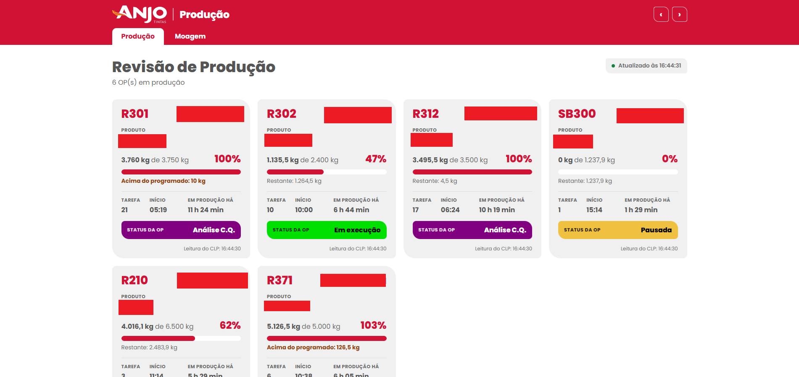
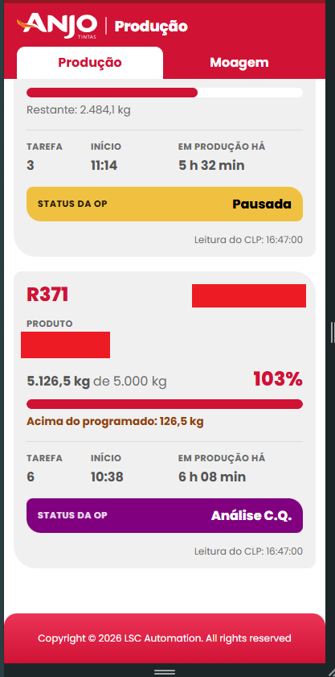
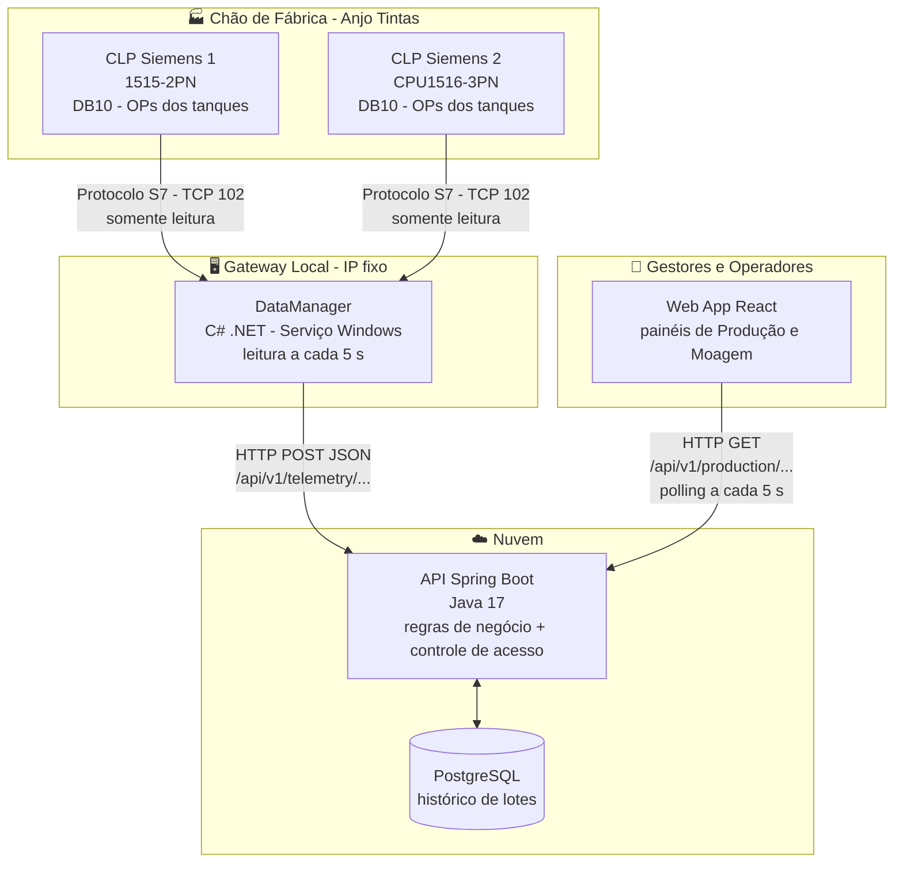

# Sistema Cloud de Monitoramento de Produção Industrial para o Setor Químico

> Projeto acadêmico desenvolvido em parceria com a **Anjo Tintas** (estudo de caso).

| | |
|---|---|
| **Integrante** | Silvio Virtuoso Júnior *(trabalho individual)* |
| **Empresa parceira** | Anjo Tintas |
| **Trilha formativa** | Automação Industrial e Engenharia de Software |

---

## Sumário

1. [Nome do integrante](#1-nome-do-integrante)
2. [Trilha formativa](#2-trilha-formativa)
3. [Título do projeto](#3-título-do-projeto)
4. [Objetivo](#4-objetivo)
5. [Justificativa](#5-justificativa)
6. [Descrição da solução](#6-descrição-da-solução)
7. [Tecnologias previstas](#7-tecnologias-previstas)
8. [Diagrama de arquitetura](#8-diagrama-de-arquitetura)
9. [Estrutura do repositório](#9-estrutura-do-repositório)
10. [Evolução do projeto (N1B)](#10-evolução-do-projeto-n1b)
11. [Entrega final (N2)](#11-entrega-final-n2)

---

## 1. Nome do integrante

**Silvio Virtuoso Júnior**: projeto desenvolvido individualmente.

## 2. Trilha formativa

**Automação Industrial e Engenharia de Software**

## 3. Título do projeto

**Sistema Cloud de Monitoramento de Produção Industrial para o Setor Químico**

## 4. Objetivo

Desenvolver uma solução de monitoramento em tempo real dos processos de **moagem** e de **fabricação de lotes** industriais na Anjo Tintas.

O sistema coleta continuamente os dados operacionais direto dos **CLPs Siemens** no chão de fábrica e os envia para uma **plataforma em nuvem**. Assim, gestores e operadores podem acompanhar de qualquer lugar as métricas de produção, as paradas e o status dos equipamentos.

## 5. Justificativa

No setor químico industrial, saber na hora em que etapa estão a mistura e a moagem é essencial para evitar **gargalos**, **perdas de matéria-prima** e **paradas não planejadas**.

Hoje esses dados ficam apenas nas telas locais (IHMs/SCADA de painel), e isso atrasa as decisões da gestão. Com os dados na nuvem:

- os dados ficam **acessíveis remotamente, em tempo real**;
- a equipe **responde mais rápido** às falhas;
- a **eficiência global dos equipamentos (OEE)** melhora.

## 6. Descrição da solução

A arquitetura tem **4 camadas**:

| # | Camada | Responsabilidade |
|---|---|---|
| 1 | **Chão de fábrica** | CLPs Siemens (S7-1500) controlam o processo químico e disponibilizam as tags operacionais em DBs. |
| 2 | **Serviço local de coleta** | Serviço residente em **C# (.NET)** que se comunica direto com os CLPs pelo protocolo **S7**, lê e interpreta as variáveis de processo no próprio local e as envia para a API. |
| 3 | **Backend / API middleware** | API em **Java com Spring Boot**: regras de negócio, autenticação e controle de acesso, persistência em banco **SQL (PostgreSQL)** e comunicação segura com a nuvem. |
| 4 | **Frontend web** | Interface **React** responsiva com os painéis de produção, os gráficos de tendência e o histórico de lotes. |

### Telas atuais

Tela de Revisão de Produção no desktop (os códigos de OP e de produto foram ocultados na imagem):



No celular:



> Os detalhes técnicos estão na **[Documentação técnica](DOCUMENTACAO-TECNICA.md)**: contratos da API REST, payloads JSON e layout do DB do CLP. Para instalar e executar, veja o **[Guia de instalação](INSTALACAO.md)**.

## 7. Tecnologias previstas

| Camada | Tecnologia |
|---|---|
| Programação do CLP | **Siemens TIA Portal** (S7-1500) |
| Coleta local | **C# (.NET 8)**, Worker Service rodando como Serviço Windows, e **Sharp7** (Snap7) para o protocolo S7 |
| Backend | **Java 17 + Spring Boot 3** |
| Banco de dados | **PostgreSQL** |
| Frontend | **React + Vite** |
| Infraestrutura | **Docker** |

---

## 8. Diagrama de arquitetura



Versão em texto:

```
[ CLPs Siemens S7-1500 ]  ──  DBs com as OPs/tanques e moinhos
            │
            ▼  Protocolo S7 (Sharp7/Snap7), somente leitura, TCP 102
[ DataManager - C# .NET (Serviço Windows, gateway local de IP fixo) ]
            │
            ▼  HTTP POST (JSON), só IPs autorizados como "gateway"
[ API Java Spring Boot (Nuvem) ]  ◄──►  [ PostgreSQL ]
            │
            ▼  HTTP GET (JSON), só IPs/usuários autorizados
[ Web App React ]  ──  painéis de Revisão de Produção e Moagem
```

---

## 9. Estrutura do repositório

```
Comunicacao-CLP-Nuvem/
├── DataManager/          # Camada 2: serviço de coleta em C# (.NET 8 + Sharp7)
├── BackEnd/              # Camada 3: API Java Spring Boot
├── FrontEnd/             # Camada 4: Web App React + Vite
├── Instalacao/           # Scripts de instalação como Serviços Windows
├── Files/                # Imagens: diagrama, DB do CLP e telas
├── DOCUMENTACAO-TECNICA.md  # Contratos da API e payloads JSON
└── INSTALACAO.md            # Ferramentas e passos para rodar o projeto
```

Cada módulo tem um README próprio: [DataManager](DataManager/README.md) · [BackEnd](BackEnd/README.md) · [FrontEnd](FrontEnd/README.md) · [Instalação](Instalacao/README.md).

---

## 10. Evolução do projeto (N1B)

Até a N1B: comunicação de ponta a ponta para o acompanhamento das **OPs/reatores**.

### Chão de fábrica
- [x] Levantamento do processo de fabricação de lotes com a Anjo Tintas
- [x] Mapeamento do DB10 (`dbProducao`) e do UDT da OP (`udtOPx`, 160 bytes por tanque) no TIA Portal
- [x] Configuração dos CLPs para leitura externa (PUT/GET liberado e DBs sem acesso otimizado)

### Serviço local de coleta (C#)
- [x] Comunicação S7 com 2 CLPs (33 tanques no total), cada CLP independente do outro
- [x] Decodificação do UDT (String, Int, Real, DTL) e conversão para JSON
- [x] Envio para a API em lote (1 POST por CLP) ou individual (1 POST por OP)
- [x] Validação da configuração na inicialização
- [x] Execução como Serviço Windows, com logs no Visualizador de Eventos

### API (Spring Boot)
- [x] Endpoints de recebimento (`POST /api/v1/telemetry/reactors` e `/batch`)
- [x] Endpoint de consulta (`GET /api/v1/production/reactors`)
- [x] Regras contra dado falso: dado desatualizado (`stale`), leitura fora de ordem e relógio adiantado
- [x] Controle de acesso por IP de origem (listas `gateway` e `viewers`)
- [x] Testes automatizados (MockMvc) do recebimento e do filtro de segurança

### Frontend (React)
- [x] Tela de **Revisão de Produção** responsiva (desktop, TV e celular)
- [x] Avisos de API fora do ar e de tanque sem atualização
- [x] Identidade visual da Anjo Tintas e status da OP com as cores da IHM

### Implantação
- [x] Instalador dos serviços `ClpApi` e `DataManager` com início automático

---

## 11. Entrega final (N2)

Até a N2: **moagem**, **persistência**, **histórico**, **indicadores** e **implantação em nuvem**.

### Moagem
- [ ] Mapear no CLP o DB real dos moinhos (hoje o `plc-tags.json` aponta para um DB200 de exemplo)
- [ ] API: `POST /api/v1/telemetry/mills` e `GET /api/v1/milling/summary`
- [ ] Frontend: tela de **Moagem** com a produção diária de cada moinho

### Persistência e histórico
- [ ] Banco **PostgreSQL** (hoje o estado fica apenas em memória)
- [ ] Gravação do histórico de lotes/OPs finalizadas
- [ ] Tela de **histórico de lotes** com filtros por período, tanque e produto
- [ ] **Gráficos de tendência** de produção

### Indicadores
- [ ] Registro de **paradas** e status dos equipamentos
- [ ] Cálculo e painel de **OEE**

### Segurança e infraestrutura
- [ ] Autenticação de usuários na API e no Web App
- [ ] Comunicação via **HTTPS**
- [ ] Containers **Docker** (API + PostgreSQL)
- [ ] Implantação em nuvem, liberando o IP fixo do gateway da fábrica

### Qualidade e entrega
- [ ] Testes automatizados do DataManager
- [ ] Validação em produção com os operadores e a gestão da Anjo Tintas
- [ ] Documentação final e apresentação

---

<sub>Projeto acadêmico de Silvio Virtuoso Júnior, com a Anjo Tintas como estudo de caso.</sub>
